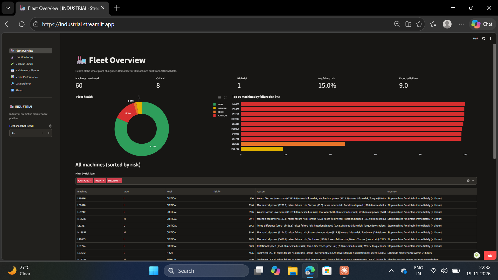
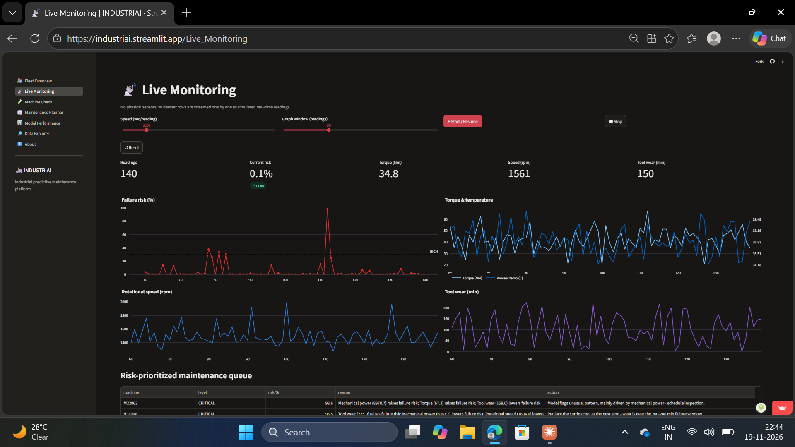
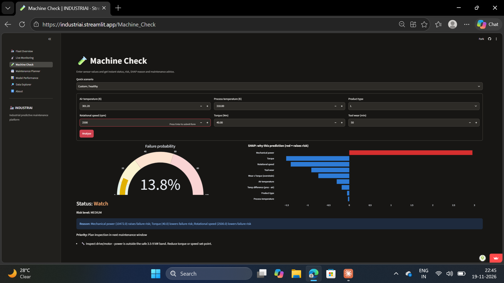
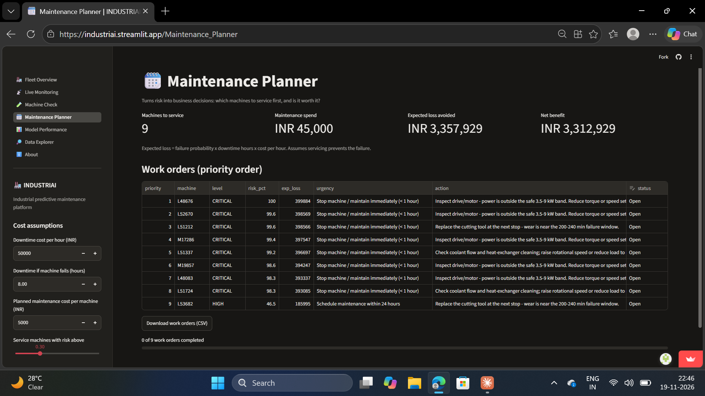
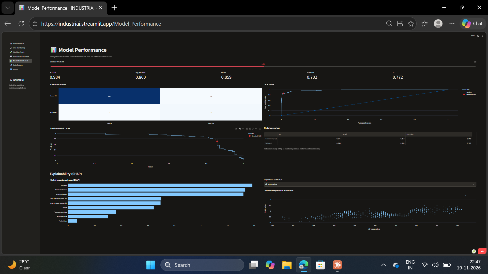
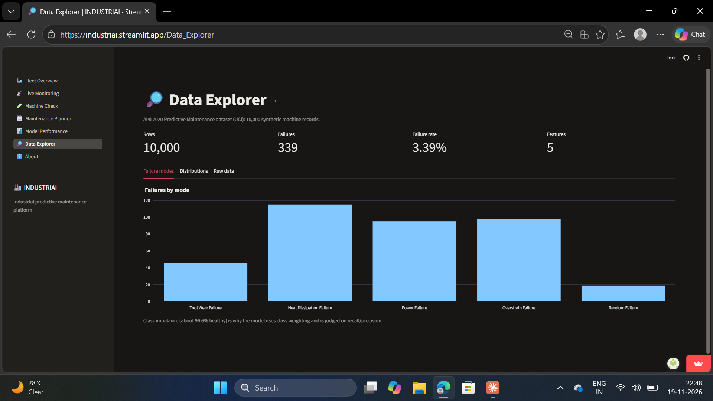

# INDUSTRIAI - Industrial Predictive Maintenance Platform


Predicts machine failure, explains every prediction with SHAP, prioritizes risk and recommends maintenance actions.

**Live demo:** https://industriai.streamlit.app

## Screenshots
**Fleet overview** - plant health, top-risk machines and per-machine drill-down



**Live monitoring** - simulated real-time sensor stream with live charts and a risk-prioritized queue



**Machine check** - manual input with status, risk, SHAP reason and maintenance advice



**Maintenance planner** - expected loss, work orders and net benefit of servicing



**Model performance** - confusion matrix, ROC and PR curves, threshold control, SHAP



**Data explorer**



## Pages
| Page | What it does |
|---|---|
| Fleet Overview | Plant health, top-risk machines, per-machine drill-down |
| Live Monitoring | Dataset replayed row by row as a simulated sensor stream |
| Machine Check | Manual input form with preset failure scenarios |
| Maintenance Planner | Expected downtime loss, work orders, net benefit of servicing |
| Model Performance | Confusion matrix, ROC, PR curve, threshold tuning, SHAP |
| Data Explorer | Failure modes, distributions, correlations, raw data |
| About | Pipeline, limitations, stack |

## Features
- **Live monitoring:** the AI4I 2020 dataset is replayed row by row as simulated sensor readings, with live Plotly charts and a risk-prioritized maintenance queue.
- **Manual check:** enter air/process temperature, speed, torque and tool wear to get status, risk %, SHAP reason and recommended actions instantly.
- **Explainability:** SHAP (TreeExplainer) per-prediction and global feature importance.
- **Maintenance logic:** physics-based failure-mode rules (tool wear, heat dissipation, power, overstrain) combined with model risk.

## Model
Random Forest and XGBoost are trained on engineered features (temperature difference, mechanical power, wear x torque); the one with the best ROC-AUC is deployed.

| Model | ROC-AUC | Recall | Precision |
|---|---|---|---|
| Random Forest | 0.971 | 0.812 | 0.908 |
| XGBoost | 0.982 | 0.859 | 0.689 |

25% stratified hold-out. The dataset is simulated/synthetic (UCI AI4I 2020), so results are a prototype benchmark, not proof of real-plant performance.

## Tech stack
Python, Pandas, scikit-learn, XGBoost, SHAP, Streamlit, Plotly, pytest, GitHub Actions, Docker.

## Run locally
```
py -m venv .venv
.venv\Scripts\pip install -r requirements.txt
.venv\Scripts\python src\core.py
.venv\Scripts\python -m streamlit run app.py
```

## Run with Docker
```
docker build -t industriai .
docker run -p 8501:8501 industriai
```
The image is built on every push by CI and was also run locally (Docker Desktop, health check and UI verified).

## Tests
```
pip install -r requirements-dev.txt
ruff check .
pytest -q
```

## Structure
```
app.py            Fleet Overview (home page)
pages/            Live Monitoring, Machine Check, Planner, Model Performance, Data Explorer, About
src/core.py       data, features, models, SHAP, risk and recommendations
src/ui.py         shared Streamlit helpers (charts, fleet, caching)
tests/            unit tests
Dockerfile        container build
.github/workflows CI
```

## Future work
Real sensor ingestion (MQTT/OPC-UA), model drift monitoring, per-failure-mode classifiers, alert notifications.
